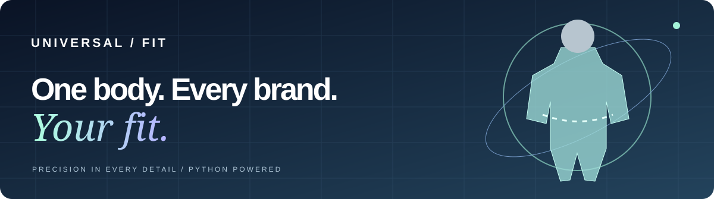
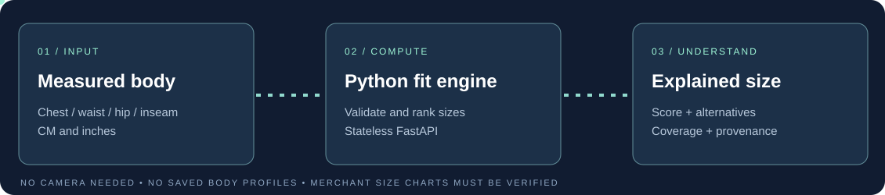
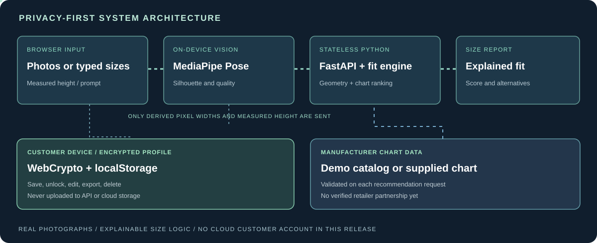

  

# Universal Fashion Size

**One body. Every brand. Your fit.**

A real-photo, AI-assisted fitting studio with a privacy-first measurement workflow, an explainable Python sizing engine, and reusable encrypted customer measurements.

[**Live Website**](https://universal-fasion-size.vercel.app/) · [**API Documentation**](https://universal-fasion-size.vercel.app/api/docs) · [**How It Works**](#how-it-works) · [**Architecture**](#system-architecture) · [**Run Locally**](#local-development)

---

## Product Overview

Fashion sizing is inconsistent: the same customer can wear different labelled sizes across styles, garments, and brands. **Universal Fashion Size** brings measurement collection, fitting guidance, and reusable customer preferences into one accessible web experience.

The live site uses **real editorial fashion photography**, not cartoons. It offers two complementary input paths: customer-supplied measurements (including natural-language values with explicit units) and an **experimental** guided front-and-side photo assessment. A validated Python API compares reviewed body dimensions to a garment size chart and returns an explainable size recommendation.

**Product honesty:** The platform is a functional public application, but it is **not yet a scientifically validated photo body scanner or a fully integrated merchant sizing service**. Photo-derived circumferences are rough, the shipped garment catalog is fictional demonstration data, and customer profiles currently persist **only in encrypted storage on the same device**.

## Current Experience

  

Real fashion photograph used in the public site. Photography: sammy swae / Unsplash. The application UI, not this photograph, contains the interactive capture and fitting controls.

The responsive studio includes:

| Experience | Working behavior | Current boundary |
| --- | --- | --- |
| **Photographic fashion website** | Editorial real-photo hero, guided capture interface, accessible responsive styling | Requires internet to load remote editorial imagery |
| **Front + side photo capture** | Accepts JPEG, PNG and WebP; displays previews with on-device analysis consent | Images must be full-body, well lit and appropriately positioned |
| **Pose and silhouette detection** | Browser-side MediaPipe Pose Landmarker, segmentation mask and quality checks | Dependent on model download and supported browser |
| **Estimated body circumferences** | Python geometry calculates rough chest, waist and hip estimates from two views and measured height | **Low-confidence estimates; not calibrated or guaranteed accurate** |
| **Prompt-based measurements** | Parses explicitly labelled dimensions with cm/in units; does not invent missing values | Not an unrestricted generative AI measurement interpreter |
| **Manual measurements** | Chest, waist, hips, inseam; cm/in switching | Customer should verify with a measuring tape |
| **Size recommendation** | Tops, bottoms, dresses; slim, regular, relaxed fits; ranked sizes and explanations | Matching is heuristic, not a verified purchase-success predictor |
| **Encrypted local profile** | Create, unlock, edit, lock, export/import and delete reviewed measurements | Saved in this browser, not a cross-device account |
| **Custom merchant size chart API** | Accepts validated user-supplied body-size ranges | No verified merchant integration or persistent chart service |
| **Six example products** | Functional demonstration with sample-size charts | Clearly fictional catalog; not live inventory |

### Functional status

- **Implemented and browser-tested:** Real fashion images, measurement prompt parsing, fitted size recommendations, and encrypted local-profile create / lock / unlock / restore.
- **Implemented and API-tested, experimental:** Two-view geometric estimation and related validation cases.
- **Not yet validated with ground truth:** Accuracy of real-user photo measurements across different bodies, clothing, cameras and environments.
- **Not yet integrated:** Cloud registration, automatic multi-device profile synchronization, real retailer inventory and paid checkout.

## How It Works

  

1. **Choose your input.** Enter known measurements, write a labelled measurement sentence, or optionally select a real front and side full-body photograph.
2. **Analyze locally, if photos were chosen.** After explicit consent, the browser loads MediaPipe and processes your images on your device. Image pixels are not sent to our FastAPI server.
3. **Review the result.** Only silhouette geometry and measured height are submitted to the Python photo-estimate endpoint. Estimated circumferences are shown with a broad cautionary range. The customer can correct the numbers with a tape before using them.
4. **Fit or securely save.** The user can calculate a clothing size immediately, or encrypt and save the reviewed measurements on this device for future visits. Unlocking the profile on a return visit restores the saved values.

### Guided photo assessment

The photo-analysis pipeline uses **real code rather than static mock responses**:

- Browser MediaPipe Pose Landmarker, version 0.10.32, detects body keypoints and a person segmentation mask.
- Quality checks reject incomplete, clipped, blurry-to-detect, or implausible capture geometry where identifiable.
- The front and side silhouette widths are approximately scaled using the customer's supplied, measured height.
- Python approximates chest, waist and hip perimeters using an elliptical cross-section formula.
- The API returns **low-confidence values** with an illustrative **±23% advisory range**. This is **not a statistically calibrated confidence interval**. It is not suitable for exact tailoring.
- A customer must explicitly review/apply suggested values before they enter the fitting form; the process does **not** pretend to infer an accurate inseam from images.

> **Accuracy warning:** Two ordinary photographs cannot reliably reveal exact anatomical circumference. Camera geometry, clothing, perspective, posture, and segmentation can introduce large error. For actual purchasing decisions, confirm measurements with a tape. This release does not assert production-grade accuracy or independently validated outcomes.

Technical implementation, privacy controls, data flow and methodological limitations are documented in **[Photo Measurement Engineering Notes](docs/PHOTO_MEASUREMENT.md)**.

### Measurement text example

Enter the following in the measurement prompt:

~~~text
Height 175cm, chest 96cm, waist 81cm, hips 100cm, inseam 78cm.
~~~

The application recognizes the measurement names and units and populates the matching fields. It does not infer body measurements from vague appearance descriptions or silently manufacture omitted numbers.

## Reusable Customer Profile

The current profile is a **private, encrypted local vault**, not a cloud identity service.

| Operation | Behavior |
| --- | --- |
| Create | Customer names a profile, reviews measurements, explicitly consents to saving, and sets a passphrase of at least 12 characters |
| Encrypt | The browser derives a key via PBKDF2-SHA256 (310,000 iterations), then encrypts data with AES-256-GCM |
| Return visit | The encrypted profile remains on the **same browser/device** until cleared; enter the passphrase to unlock and repopulate measurements |
| Update | Adjust measurements and explicitly save changes |
| Export / import | Download and transfer an **encrypted JSON backup** for restoration on another device |
| Delete | Remove the profile from this browser |
| Photographs | Photo files are **not included** in the saved profile |

**Limitations:** Browser/device clearing can erase a locally saved profile. The platform cannot recover a forgotten passphrase. An encrypted local profile is not equivalent to cloud authentication, a vetted identity service, or automatic sync across laptops and mobile devices.

A true multi-device customer experience requires a dedicated identity provider, protected database, authorization/row isolation, encryption and deletion policy, consent management, and recovery processes. No unrelated project's database is reused for this application.

## System Architecture

| Layer | Technology | Purpose |
| --- | --- | --- |
| Presentation | HTML5, CSS3, JavaScript, Vercel CDN | Responsive customer interface and editorial photography |
| Vision processing | Browser MediaPipe Pose + WebAssembly | Opt-in pose and silhouette extraction; no photo-byte upload |
| Customer profile | Browser WebCrypto + encrypted localStorage | Same-device measurement persistence and encrypted backup |
| API | Python 3.12, FastAPI, Pydantic v2 | Input validation, catalog, recommendations and rough geometry estimation |
| Photo geometry | Python, Ramanujan ellipse approximation | Constrained, quality-gated estimates with documented limitations |
| Fitting engine | Deterministic typed Python | Category-weighted size selection, alternatives, coverage and provenance |
| Catalog | Six fictional examples or caller-provided charts | Demonstrate calculations without falsely implying retailer partnerships |
| Verification | pytest, GitHub Actions | Unit tests for sizing, endpoints, validation and negative cases |
| Hosting | Vercel Python Functions + CDN | Public web experience and stateless API |

**Data separation:** Photo pixels stay in the browser. A photo assessment sends *derived silhouette widths, image-body heights, height and quality scores* to the API. The size recommendation sends *measurements and selected chart information* to the API. Encrypted profiles stay in browser storage and are not uploaded to the API.

### Repository structure

~~~text
universal-fasion-size/
├── app.py                              # FastAPI application and sizing engine
├── photo_fit.py                        # Experimental two-view geometry endpoint
├── public/
│   ├── index.html                      # Real-photo customer interface
│   └── assets/
│       ├── style.css                   # Responsive visual design
│       ├── app.js                      # Product catalog and fitting UI
│       ├── photo-fit.js                # On-device silhouette analysis and prompts
│       ├── profile-vault.js            # Browser-local encrypted measurement vault
│       └── logo.svg
├── tests/
│   ├── test_api.py
│   └── test_photo_fit.py
├── docs/
│   ├── banner.svg                      # Animated, non-cartoon brand graphic
│   ├── animated-workflow.svg           # Animated customer journey
│   ├── architecture.svg                # Data-flow and privacy architecture
│   ├── PHOTO_MEASUREMENT.md
│   └── DEPLOYMENT.md
├── .github/
│   ├── workflows/ci.yml
│   ├── copilot-instructions.md
│   └── skills/
│       ├── github-readme-standard/SKILL.md
│       └── project-memory-manager/SKILL.md
├── memory/PROJECT_MEMORY_2026-11-04.md
├── Dockerfile
├── requirements.txt
├── pyproject.toml
├── vercel.json
├── PROJECT_CONTEXT.md
├── CHANGELOG.md
└── LICENSE
~~~

## Local Development

**Requirements:** Python 3.12+, a modern browser, and internet access for the optional MediaPipe model download.

~~~bash
git clone https://github.com/hossain0707/universal-fasion-size.git
cd universal-fasion-size

python -m venv .venv

# macOS / Linux:
source .venv/bin/activate

# Windows PowerShell:
# .venv\Scripts\Activate.ps1

python -m pip install -r requirements.txt
uvicorn app:app --reload
~~~

- Web application: **http://localhost:8000/**
- OpenAPI reference: **http://localhost:8000/api/docs**
- API status: **http://localhost:8000/api/health**

### Tests

~~~bash
python -m pip install "pytest>=8,<10" "httpx>=0.27,<1"
python -m compileall -q app.py photo_fit.py tests
python -m pytest -q
~~~

CI runs the Python tests on pushes to **main** and on pull requests. The passing workflow verifies executable behavior and validation cases, not real-world photo measurement accuracy.

### Docker

~~~bash
docker build -t universal-fashion-size .
docker run --rm -p 8000:8000 universal-fashion-size
~~~

## API

The API is interactive at **[the public Swagger UI](https://universal-fasion-size.vercel.app/api/docs)**.

| Method | Path | Purpose |
| --- | --- | --- |
| GET | \`/api/health\` | Health check |
| GET | \`/api/catalog\` | Six fictional example garments and size charts |
| GET | \`/api/catalog/{product_id}\` | Individual garment details |
| POST | \`/api/recommend\` | Ranked fitting recommendation with explanations |
| POST | \`/api/photo/assess\` | Estimate approximate circumferences from derived *front/side silhouette geometry*, not uploaded images |
| GET | \`/api/methodology\` | Method summary and limitations |
| GET | \`/api/docs\` | Interactive Swagger UI |
| GET | \`/api/openapi.json\` | OpenAPI schema |

### Calculate a size

~~~bash
curl -sS https://universal-fasion-size.vercel.app/api/recommend \
  -H "Content-Type: application/json" \
  -d '{"category":"tops","fit":"regular","product_id":"foundation-tee","measurements":{"chest_cm":96,"waist_cm":81}}'
~~~

The fictional Foundation Tee example has returned **M**, a heuristic score of **93.8/100**, and full input coverage in a public browser test. That score is **not** a probability or a measured retail fit-success rate.

### Submit a custom body-size chart

~~~json
{
  "category": "tops",
  "fit": "regular",
  "measurements": {
    "chest_cm": 96,
    "waist_cm": 81
  },
  "custom_chart": {
    "name": "Example merchant shirt chart",
    "category": "tops",
    "sizes": [
      {
        "size": "S",
        "measurements": {
          "chest_cm": {"min": 84, "max": 94},
          "waist_cm": {"min": 68, "max": 80}
        }
      },
      {
        "size": "M",
        "measurements": {
          "chest_cm": {"min": 92, "max": 104},
          "waist_cm": {"min": 78, "max": 90}
        }
      }
    ]
  }
}
~~~

Submit that JSON to **POST \`/api/recommend\`**. Chart measurements represent *body-size ranges in centimetres*, not physical garment dimensions. The custom chart is used for the request, not permanently stored.

### Photo geometry endpoint

**POST \`/api/photo/assess\`** accepts bounded numeric data (two silhouette heights in pixels, front and side chest/waist/hip widths, pose quality, and measured stature). It explicitly **does not accept image uploads**. The endpoint returns rough circumference estimates, a cautionary range, quality status and limitations, or an HTTP 422 validation response.

For the exact request schema, validation and methodological details, consult the **[OpenAPI docs](https://universal-fasion-size.vercel.app/api/docs)** and **[engineering notes](docs/PHOTO_MEASUREMENT.md)**.

## Fitting Methodology

The deterministic sizing engine compares available measurements against declared body-size intervals. It uses category-specific weighting, fit-preference heuristics and a normalized distance scoring function.

| Category | Relevant dimensions and weights |
| --- | --- |
| Tops | Chest 70%; waist 30% |
| Bottoms | Waist 55%; hips 35%; inseam 10% |
| Dresses | Chest 40%; waist 30%; hips 30% |

Fit preferences use prototype ease adjustments: **slim −1 cm**, **regular 0 cm**, **relaxed +3 cm**. Incomplete input reduces measurement coverage. The numeric fit score is a ranking heuristic, **not a confidence probability**, and the coverage score reflects supplied measurements, **not measurement precision**.

Manufacturer-specific sizing, stretch, drape, garment type, mobility, manufacturing tolerances and personal preference all affect fit. Height may be provided, but the current garment ranking does not use height as a weighted measurement.

## Security and Privacy

- Browser-selected photos are processed on the device; the photo API receives only derived measurements. Images are not saved to the customer profile or server.
- MediaPipe and WASM assets are downloaded from external Google/CDN locations **only after explicit photo-analysis consent**. Those providers may process normal network request metadata.
- Local customer profiles are encrypted with **AES-GCM**, and the decryption key is derived from the user's passphrase. No passphrase is sent to the fitting API.
- Python endpoints use strict Pydantic input validation, body dimension boundaries and basic response security headers.
- Users can review, change, export and delete encrypted local-profile data.
- This release does **not** claim a third-party penetration test, scientific measurement certification, GDPR compliance audit, full infrastructure rate-limiting or security hardening for large-scale merchant deployment.

## Deployment and Verification

**Production:** https://universal-fasion-size.vercel.app/

The FastAPI backend runs on **Vercel Functions**; static files are delivered through Vercel's CDN.

**Important:** Source was deployed directly through Vercel because the Vercel GitHub integration is not currently linked to this repository. **Pushing a commit to GitHub does not automatically update the live website** until that integration is configured. See the [deployment and verification guide](docs/DEPLOYMENT.md).

Verification performed on November 4, 2026:

- GitHub Actions passed Python compilation and pytest, including photo geometry validation cases.
- Public browser testing verified real-photography rendering, labelled measurement prompt parsing, real API size computation, encrypted local profile creation, locking/unlocking and measurement restoration.
- Public endpoints, homepage and browser-side asset files loaded in the deployed application.
- **Not verified:** A measured end-to-end evaluation of image-derived sizes against ground-truth tape measurements across actual customers. Do not misinterpret passing unit tests as model accuracy evidence.

## Roadmap

| Phase | Scope | State |
| --- | --- | --- |
| 1. Core size calculation | Validated inputs, sample charts, deterministic fitting engine | **Implemented** |
| 2. Real-photo interface | Responsive editorial photography and guided capture | **Implemented** |
| 3. Experimental photo estimation | Browser-local pose/segmentation and Python geometry endpoint | **Implemented; accuracy not independently validated** |
| 4. Reusable local profile | Encrypted same-device profile and backup | **Implemented** |
| 5. Real-world accuracy study | Consent-based benchmark with tape measurements, camera calibration and multiple body types | **Pending** |
| 6. Persistent accounts | Separate managed Auth + Postgres, row-level authorization, recovery and deletion | **Pending infrastructure** |
| 7. Merchant integrations | Verified brand charts, versioned imports, retailer workflows | **Pending** |
| 8. Commercial readiness | Model error thresholds, fit outcome studies, security review, monitoring, scaling and accessibility audit | **Pending** |

## Project Documentation

- **[Photo Measurement Engineering Notes](docs/PHOTO_MEASUREMENT.md)** — algorithms, consent, quality rules, privacy and accuracy limitations.
- **[Deployment Guide](docs/DEPLOYMENT.md)** — how the current Vercel release is deployed and how to enable Git integration.
- **[Project Context](PROJECT_CONTEXT.md)** — implementation decisions and known boundaries.
- **[Changelog](CHANGELOG.md)** — release history.
- **[Project Memory](memory/PROJECT_MEMORY_2026-11-04.md)** — dated work record for future development.
- **[Repository Skills](.github/skills)** — README authoring and project-memory conventions.

## Ownership and License

**Copyright © 2026 Md Najmul Hossain. All rights reserved.**

This repository is public for viewing, but is **not open source**. No license is granted for unauthorized copying, modification, distribution or commercial reuse. Refer to [LICENSE](LICENSE) for the applicable terms.

---

  <strong>UNIVERSAL / FIT</strong> 
  Measure thoughtfully · Fit transparently · Own your information  
  <a href="https://universal-fasion-size.vercel.app/">Live Fitting Studio</a> ·
  <a href="https://universal-fasion-size.vercel.app/api/docs">Developer API</a> ·
  <a href="https://github.com/hossain0707/universal-fasion-size/issues">Issues & Feedback</a>

